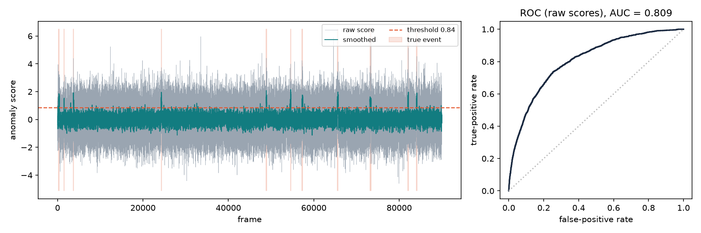

# vadeval

[](https://github.com/<your-username>/vad-eval/actions/workflows/ci.yml)
[](LICENSE)


**Evaluation toolkit for video anomaly detection.**

Papers on abnormal-behaviour detection report frame-level ROC-AUC. Operators in a
control room care about something else: how often the system calls them for nothing,
and how many real incidents it catches. `vadeval` computes both from the same score file.

| Metric | Function | Question it answers |
|---|---|---|
| ROC-AUC | `roc_auc` | Does the model rank abnormal frames above normal ones? |
| Average precision | `average_precision` | How good is the ranking when events are rare? |
| False alarms per shift | `false_alarms`, `false_alarms_per_hour` | How often is the operator called for nothing? (alarms within a tolerance window around an event are not counted) |
| Event recall | `event_recall` | What share of real incidents is caught? |
| Threshold calibration | `calibrate_threshold` | Which threshold catches most events within an alarm budget? |

Part of the research project *Models and Methods for Detecting Abnormal Behaviour in
Video Surveillance Systems*.

## Installation

```bash
git clone https://github.com/<your-username>/vad-eval.git
cd vad-eval
python -m venv .venv && source .venv/bin/activate   # Windows: .venv\Scripts\activate
pip install -e ".[plot]"          # users
pip install -e ".[dev]"           # contributors (tests, linter)
```

Requires Python 3.10+. The only runtime dependency is NumPy; Matplotlib is optional.

## Quick start

Command line:

```bash
vadeval synth examples/demo.csv --frames 90000 --events 12   # one synthetic hour at 25 FPS
vadeval evaluate examples/demo.csv --fps 25 --max-fa-per-shift 2 --plot examples/report.png
```

```json
{
  "frames": 90000,
  "hours": 1.0,
  "roc_auc_raw": 0.8087,
  "roc_auc_smoothed": 0.9937,
  "average_precision_smoothed": 0.9271,
  "threshold": 0.845,
  "false_alarms": 0,
  "false_alarms_per_shift": 0.0,
  "event_recall": 1.0
}
```

Smoothing lifts AUC from 0.81 to 0.99 on this synthetic stream, and the calibrated
threshold keeps false alarms within the budget of 2 per 8-hour shift.



Python:

```python
import vadeval as ve
from vadeval.io import load_csv

scores, labels = load_csv("examples/demo.csv")
smooth = ve.moving_average(scores, window=12)  # causal: no look-ahead
cal = ve.calibrate_threshold(smooth, labels, fps=25, max_false_alarms_per_shift=2, min_frames=12)
print(ve.roc_auc(labels, scores), cal.threshold, cal.event_recall)
```

## Input format

A CSV file with a header and one row per frame:

```
score,label
0.1253,0
2.4410,1
```

`score` is the detector's anomaly score (higher = more abnormal); `label` is the ground
truth (1 = abnormal frame).

## Development

```bash
pytest --cov=vadeval        # tests + coverage (CI fails below 90 %)
ruff check . && ruff format --check .
```

Workflow: create a branch from `main`, open a pull request, CI must pass before merge.
See [CONTRIBUTING.md](CONTRIBUTING.md).

## CI/CD

* [`ci.yml`](.github/workflows/ci.yml) — on every push and pull request: lint, tests on
  Python 3.10–3.12 (Linux) and 3.12 (Windows), coverage gate, package build, demo report
  artifact.
* [`release.yml`](.github/workflows/release.yml) — on a version tag `v*`: runs the tests,
  builds wheel and sdist, publishes a GitHub Release with the files attached.

## Citation

If you use `vadeval` in research, please cite it using [CITATION.cff](CITATION.cff).

## License

[MIT](LICENSE)
